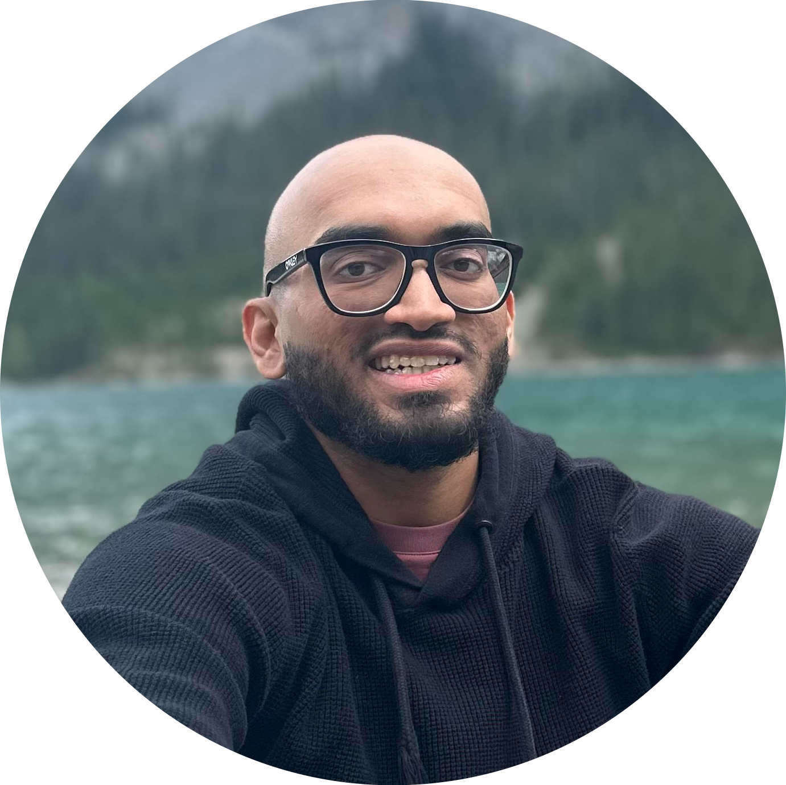

<header class="home-header">
  <nav class="home-nav" aria-label="Primary navigation">
    <a href="/projects.html">Research</a>
    <a href="/books.html">Bookshelf</a>
    <a href="#contact">Contact</a>
  </nav>
</header>

  
  <nav class="profile-links" aria-label="Professional profiles">
    <a href="https://github.com/greninja" target="_blank" rel="noopener noreferrer" aria-label="GitHub" title="GitHub">
      <i class="fa fa-github" aria-hidden="true"></i>
    </a>
    <a href="https://www.linkedin.com/in/shadab-shaikh-1251bb110/" target="_blank" rel="noopener noreferrer" aria-label="LinkedIn" title="LinkedIn">
      <i class="fa fa-linkedin" aria-hidden="true"></i>
    </a>
    <a href="https://scholar.google.com/citations?user=Qg0JXqYAAAAJ&amp;hl=en" target="_blank" rel="noopener noreferrer" aria-label="Google Scholar" title="Google Scholar">
      <svg class="scholar-icon" viewBox="0 0 24 24" aria-hidden="true" focusable="false">
        <path d="M12 24a7 7 0 1 0 0-14 7 7 0 0 0 0 14zm0-24L0 9.5l4.8 3.6A8 8 0 0 1 12 8a8 8 0 0 1 7.2 5.1L24 9.5z"/>
      </svg>
    </a>
  </nav>

  
🚀 Open to full-time as well as short-term contract roles in ML / AI / Systems Engineering

<!-- I finished my Masters (thesis) in Computer Science from the [University of British Columbia](https://www.cs.ubc.ca/) (Vancouver). I was working with Prof. [Mathias Lecuyer](https://mathias.lecuyer.me/), as part of a Systems lab, fondly called [Systopia](https://systopia.cs.ubc.ca/). My Master's thesis was on the topic of adversarial robustness of machine learning models. Check more details here: [Paper](https://shadabs.com/research/2024/08/01/ars.html) and [Thesis](https://open.library.ubc.ca/soa/cIRcle/collections/ubctheses/24/items/1.0445441).

In a previous life, I completed my undergraduate (majoring in Computer Engineering) at University of Pune (India) from 2014 to 2018. During and after my undergraduate, I have worked on topics ranging from Systems Biology, Manifold learning, Privacy and Security of Machine Learning. I also contributed towards building a distributed and automated data science pipeline to synthesize images from a radio telescope.

I carried out these projects during my visits to *University of Waterloo* (with [Prof. Xi He](https://cs.uwaterloo.ca/~xihe/)), *National University of Singapore* (with [Prof. Reza Shokri](https://www.comp.nus.edu.sg/~reza/)), *Tata Institute of Fundamental Research* (with [Prof. Hari Narayanan](https://www.tifr.res.in/~hariharan.narayanan/)) and *National Centre for Radio Astrophysics* (with [Dr. Yogesh Wadadekar](http://www.ncra.tifr.res.in/~yogesh/)). I have also worked remotely with [Prof. Baharan Mirzasoleiman](http://web.cs.ucla.edu/~baharan/) on data poisoning defenses and attacks for machine learning algorithms. On these short journeys of mine, I have been incredibly fortunate to have had amazing intellectuals as my mentors and colleagues.-->

Hey 👋 I am Shadab. I’ve spent the past few years working broadly in Trustworthy AI, both during my Master’s at UBC and through research visits at a few labs across North America and Asia. Along the way, I’ve been incredibly lucky to learn from mentors and colleagues who sharpened my thinking and shaped how I approach research and engineering.

In a previous life I took a brief detour into systems biology, using ideas from formal verification to study gene regulatory networks and synthesize cell-fate determination models of C. elegans earthworm. I hope to return to similarly exciting research questions someday.

Most recently, I worked with the lovely folks at [Transformer Lab](https://github.com/transformerlab/transformerlab-app), expanding their platform’s scope and polishing its UX so AI researchers can seamlessly train, evaluate, and scale models from local hardware to GPU clusters.

## What I’m looking for next

I’d love to work at an early- or mid-stage startup or on a small research team. Ideally, I’d get to do a mix of research and engineering. I like having a hunch about why a model behaves a certain way and figuring out how to test it. I get just as much satisfaction from building something that someone else ends up using in their day-to-day work. I’d happily do either full-time.

A lot of my research has been about how well defenses for ML models hold up, so AI safety is where my mind goes first. I’m especially curious about open-weight models. Once someone can download a model and change it themselves, which safeguards can we still count on? As these models get closer to frontier performance in areas like cyber offense, I’d like to work on how we assess those risks before release and what we can build into a model that will still help afterward.

Computational biology is another area I’d be excited to work in, and I’m open to others. For me, a lot comes down to the day-to-day work and who I get to do it with. I want to work on something that matters to someone, with people whose company I enjoy and whose judgment I can learn from.

<section class="home-contact-section" id="contact" aria-labelledby="home-contact-title">
  <h2 id="home-contact-title">Contact</h2>
  
For work, collaborations, or just to say hello, email is the best way to reach me: sshadab84 [at] gmail [dot] com

</section>
